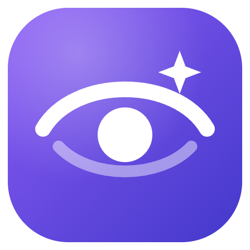

<p align="center"></p>

# Glimpse

A real-time conversation copilot for **Windows** (macOS version in progress, see [macOS](#macos-in-progress)). It listens to your call (your microphone plus the other side's audio), transcribes it locally, and shows short answers in a side panel. The panel is hidden from screen sharing and recording. Answers come from **your own notes folder first**, for example your interview notes and prepared answers.

> **Status: early development.** Pillar A (the capture-invisible overlay) is done. Audio capture, live answers and notes search are being built in that order. The progress table below tracks what works today.

## Requirements

- Windows 11, or Windows 10 version 2004 or later. Hiding from capture needs `WDA_EXCLUDEFROMCAPTURE`, which Windows added in 2004.
- Node.js 22 or later (developed on 24).
- Optional API keys, **bring your own** (Glimpse ships with none and has no server):
  - **Anthropic** (recommended): best answers. Claude Haiku 5.5, roughly $0.04 per hour of use. Create a key at console.anthropic.com → Settings → API Keys (it starts with `sk-ant-api03-`).
  - **Groq**: free tier, lower answer rate, more likely to invent personal details. Key from console.groq.com.
- No Visual Studio or other native build tools are needed.

## Install

Download `Glimpse Setup x.y.z.exe` (or build it with `npm run dist`) and run it. It installs per user, needs no admin rights, lets you pick the install folder, and includes the default speech and search models. The installer is not code-signed yet, so SmartScreen may warn: choose **More info → Run anyway**.

**Where your data lives.** Installed on a drive other than Windows (e.g. `D:\Projects\Glimpse`), Glimpse keeps everything on that drive, next to the install: `D:\Projects\Glimpse Data` (settings, encrypted keys, caches) and `D:\Projects\Glimpse Notes`. Installed on C:, it uses `%APPDATA%\Glimpse` and `Documents\Glimpse Notes`. Never inside the install folder itself, because uninstalling or updating deletes it. Run from source on a non-system drive, data goes to `.glimpse-data/` in the repo.

## macOS (in progress)

The Mac version shares all of Glimpse's code. It is built by GitHub Actions (**Actions → macOS build → Run workflow**), which produces `Glimpse-x.y.z-arm64.dmg` (Apple silicon) and `Glimpse-x.y.z-x64.dmg` (Intel). It has not yet been tested on a real Mac.

- **Requires** macOS 13 or later. System audio capture needs macOS 14.2 or later.
- **First launch:** the app is not notarized. Right-click Glimpse in Applications → **Open**, or run `xattr -cr /Applications/Glimpse.app`.
- **Permissions macOS asks for:** Microphone (your side), System Audio Recording (the other side), and Screen Recording (system audio and the capture test). Allow them in System Settings → Privacy & Security.
- **Invisible to screen sharing, with a caveat:** Glimpse uses Apple's "do not share this window" flag. Since macOS 15, apps that record through ScreenCaptureKit can ignore it, and Apple offers no way to prevent that. Run **Capture test** with each app you use, and check from a second device before relying on it.
- **Shortcuts** are Control+Option (⌃⌥G etc.). Rebind them to ⌘ in Settings → Hotkeys if you prefer.
- Data lives in `~/Library/Application Support/Glimpse`, and notes in `~/Documents/Glimpse Notes`.
- To build on a Mac: `npm ci && npm run fetch-models -- --only kroko-en,silero-vad,bge-small-en && npm run dist`.

## Getting started (from source)

```powershell
npm install
npm run dev        # run with hot reload
npm run check      # typecheck + lint + unit tests
npm run selftest   # build, then run the capture self-test headless (exit code 0 = PASS)
npm run canary     # build, then show the test pattern on the protected overlay for 60 s (for external recorders)
npm run fetch-models # download speech-recognition models into models/ (about 1.1 GB for all candidates; hashes are verified)
npm run bench:audio  # make the 24-sentence benchmark audio with the Windows voices
npm run bench:asr    # benchmark the installed models (WER, latency, real-time factor)
npm run bench:kb     # notes search accuracy (G11)
npm run bench:answer # live answers with the keys saved in Settings: time to first words (G7); close the app first
npm run dist       # build a Windows installer into release/ (download caches kept in .cache/)
```

Glimpse runs in the system tray (the menu bar on macOS). Click its icon to open Settings.

## The overlay

- A frameless, transparent, always-on-top panel on the right of the primary display. It is never focusable, so showing or hiding it does not take focus from the app you are typing in.
- **Hidden from capture.** Glimpse asks Windows to exclude the window (`WDA_EXCLUDEFROMCAPTURE`), sets that before the window is shown, then reads the setting back from Windows and **hides the overlay again if Windows says it is capturable**. On Windows 10 before version 2004, where only `WDA_MONITOR` exists, it falls back to a faint "capture-safe" overlay.
- **Click-through.** By default clicks pass through the panel to the app behind it. Only the header stays clickable, using a hit-box checked every 60 ms. Toggle with the hotkey or the Lock/Unlock button.
- **Panic hide.** One key hides the overlay and the tray icon and mutes capture. The same key brings everything back.

### Hotkeys (rebindable in Settings → Hotkeys)

| Action | Default |
|---|---|
| Show / hide overlay | `Ctrl+Alt+G` |
| Toggle click-through | `Ctrl+Alt+C` |
| Panic hide / restore | `Ctrl+Alt+H` |
| Answer the last question now | `Ctrl+Alt+Enter` |
| Elaborate (fuller answer) | `Ctrl+Alt+E` |
| Regenerate | `Ctrl+Alt+R` |
| Answer from a screenshot | `Ctrl+Alt+S` |
| Mute / unmute mic | `Ctrl+Alt+M` |
| Clear answers | `Ctrl+Alt+X` |
| Start / stop a meeting | `Ctrl+Alt+N` |

Another app may already own a shortcut (Claude Desktop's Quick Entry uses `Ctrl+Alt+Space`, for example). Glimpse then shows a notification and flags the key in Settings → Hotkeys. Pick another one there.

## Check that it really is invisible

**Settings → Capture test** has two checks:

1. **Self-test.** Paints the overlay with a magenta/green pattern, captures the display the way a recorder does, and looks for the pattern in a grid of 12 regions. A baseline capture (overlay hidden) rules out wallpaper that happens to be magenta or green. A control capture with protection switched off for a moment proves the test can see the overlay at all. The result is **PASS**, **FAIL** or **INCONCLUSIVE** (the control saw nothing), with diff images. For about half a second the control capture turns protection off, so the pattern **will appear in any recording or share that is running**. Don't run it during a live share (the button stays disabled until you confirm you aren't sharing).
2. **Live test.** Run it while you record or share your screen in a real app, in two steps:
   - **Step 1, control (5 s).** Shows the pattern *without* protection. It **must appear** in the recording or on the viewer's screen. If it doesn't, your setup can't see the screen and step 2 proves nothing.
   - **Step 2, protected (30–120 s).** Shows the pattern with protection on. It **must not appear** in the recording or on the viewer's screen.

   Then record what you saw. Results fill the capture matrix below and are kept in the app. Panic hide ends any live test and turns protection back on.

   Judge the result from the **viewer's side** (a phone or second computer in the call), not from your own screen, especially if you reach this PC remotely (see below).

### If you use Parsec, Moonlight, Remote Desktop or similar

Streaming and remote-desktop tools capture your screen the same way a recorder does. **Through them, the protected overlay is invisible to you too**: you will see no overlay and no pattern. That is the protection working, not a fault, and it follows from how Windows excludes windows from capture. To see the overlay, sit at the PC's own monitor. Glimpse looks for these tools (Parsec, Sunshine/Moonlight, AnyDesk, TeamViewer, RustDesk, Chrome Remote Desktop, VNC, Splashtop, and RDP sessions) and shows a warning on the Capture test tab. The warning is a hint: a running process does not prove a session is active.

The self-test result (verdict and per-region numbers) is saved. The diff images show a strip of your actual screen, so they are **never saved**. `npm run selftest` writes them to `%TEMP%\glimpse-selftest` — delete them when you are done.

### Capture matrix (Windows)

"PASS" means the overlay was absent from the shared or recorded image. Rows marked *automated* were verified by Glimpse's own tests on Windows 11 build 26300; the rest need a person with the app and are not yet tested.

| Tool | Result | Notes |
|---|---|---|
| Electron `desktopCapturer` (same path browsers and Electron-based recorders use) | PASS | Automated self-test, 0 overlay pixels, control saw 100% |
| GDI `CopyFromScreen` (classic screenshot / BitBlt path) | PASS | Automated, separate process: 0 of 282,240 overlay-region pixels; a normal magenta window in the same shot was 20,000 of 20,000 |
| Zoom screen share | — | Not tested |
| Google Meet (Chrome) share | — | Not tested |
| Microsoft Teams share | — | Not tested |
| OBS Display Capture | — | Not tested |
| OBS Window Capture (WGC) | — | Not tested |
| Snipping Tool / Win+Shift+S | — | Not tested |
| Xbox Game Bar recording | — | Not tested |
| Loom | — | Not tested |
| Discord screen share | — | Not tested |

Windows 10 before 2004 (`WDA_MONITOR` capture-safe mode) is implemented but has not been tested.

## Audio and transcription (Pillar B)

- **Them** is everything your speakers or headset play (the other side of the call), captured as Windows loopback audio. **You** is your microphone, with echo cancellation, noise suppression and automatic gain. Pick the mic, watch both meters and mute either one in **Settings → Audio**.
- Speech recognition runs **on this PC**. The default model is Kroko (55 MB); Nemotron 0.6B (447 MB) is optional. A voice detector ends each utterance about 0.4 s after you stop talking. Measured on this PC: speech end to text ≈ 0.5 s (p95 ≈ 0.55 s).
- Unplug a microphone and Glimpse keeps the call going on system audio, falls back to the Windows default mic and comes back when you plug it in. After 5 failed attempts a source pauses with the reason and a **Retry** button.
- First run: `npm run fetch-models -- --only kroko-en,silero-vad` (about 56 MB).

## Answers and your notes (Pillar C)

- When the other side asks a question, Glimpse answers on the overlay in under 55 words. Turn auto-answer and fact-checking on or off in **Settings → Answers**; add your resume or job description there too.
- **Your notes come first.** In **Settings → Notes**, **Add files…** copies files into the notes folder (see *Where your data lives*; from source it is `notes/`). **Open notes folder** opens it, and **Change folder…** points Glimpse at any folder you like (**Use default** switches back). Supported: .md .txt .docx .pdf .json .csv. Write prepared answers as `Q: … / A: …` or as a heading ending in `?`. A matching prepared answer appears instantly, marked *from your notes*, then the model refines it. Search runs on this PC (keyword + a local embedding model).
- **Pick a provider** under **Use**: Auto (Claude if its key is saved, else Groq), Anthropic only, or Groq only. Without a key, prepared answers from notes still work.
- Measured on this PC (`npm run bench:answer`, 8 questions): Claude first words p50 362 ms / p95 423 ms; Groq p50 391 ms with occasional free-tier delays (p95 1.7 s). Add ~0.5 s of speech-recognition time for a spoken question.

## Meetings and minutes

Start a meeting in **Settings → Meetings** (or press `Ctrl+Alt+N` from any app), and stop it the same way. While it runs, every transcript line is saved on this computer, so a crash or a forced quit keeps it (the meeting shows as *Interrupted* and you can still write its minutes). When you stop, Glimpse writes the minutes with your answer provider (Claude Sonnet 5.5, or Groq):

- **Summary**, **Decisions**, **Action items** (`- [ ] Owner — task (due)`), **Open questions** and **Key details** (names, numbers, dates).
- Copy them, export the minutes plus the full transcript as Markdown, rewrite them, rename or delete the meeting.
- By default the minutes (not the transcript) are also saved to `<notes folder>/Meetings/`, so later answers can draw on past meetings. Turn this off in Meeting settings.
- **Record calls I join automatically** (off by default): when a call app opens your microphone, Glimpse starts a meeting, and it stops about 20 seconds after the app lets go of the mic. This works with Zoom, Teams, Webex, Slack huddles, Skype, GoTo, RingCentral, and Google Meet, Teams or Zoom in a browser. Glimpse reads the same Windows record that lights the taskbar's mic icon. A browser counts only when a call tab is in front, or when a calendar meeting with a call link is on. Recording starts after the app has held the mic for 5 seconds, so a quick mic test doesn't count. A calendar meeting you don't join is never recorded. You get a notification on every start and stop. If you stop the recording yourself, Glimpse won't restart it during that call, and it never stops a meeting you started yourself.
- **When Glimpse listens:** *Always* (default; live answers work any time) or *Only during meetings* (microphone and system audio are off until you start a meeting).
- Long meetings are summarised in one pass with Claude; with Groq's free tier they are split into parts and merged.
- `npm run bench:minutes` writes minutes for a scripted sample call with your saved keys and checks the sections and key facts.

Recording laws differ by place, and many require everyone on the call to agree to being transcribed: tell the others when you start a meeting.

### Calendar

Connect your calendar in **Meetings → Calendar** with its private iCal address. It's read-only, with no Google sign-in, and Glimpse never changes your calendar.
- **Google Calendar** (web): Settings → your calendar → Integrate calendar → *Secret address in iCal format*.
- **Outlook**: Settings → Calendar → Shared calendars → Publish a calendar → ICS link.

The address is stored encrypted, like the API keys, and never shown again. Treat it like a password: reset it in your calendar's settings if it leaks. Glimpse syncs every 5 minutes and then:
- Lists what's happening now and in the next 24 hours, with **Brief** and **Record** buttons.
- **Brief me before meetings** (on by default): 5 minutes before a meeting with other people or a call link, the overlay shows who you're meeting and what to prepare. The brief comes from the invite and your notes.
- A meeting started without a title, including one recorded automatically when you join a call, is named after the calendar meeting happening now.

Repeating meetings, moved or cancelled repeats, and time zones are handled by [ical.js](https://github.com/kewisch/ical.js).

## Companion page (phone or second computer)

Turn it on in **Settings → Companion**, then scan the QR code. It shows the live transcript and the answers on another device. This is useful when you view this PC through Moonlight or Parsec, where the overlay is hidden from you. It is served from this PC only, never through the internet. By default only this PC can open it; **Allow other devices** opens it to your home network and Tailscale. Every link carries a random access code; **New access code** invalidates old links.

## Privacy

- Speech recognition will run **on your machine**. Audio is never uploaded unless you turn on the optional cloud accuracy setting.
- Only the transcript excerpt and the matching snippets from your notes are sent to the LLM provider whose key you configure.
- There is no account and no telemetry. API keys are encrypted with Windows DPAPI through Electron `safeStorage`.

## Progress

| Milestone | What it delivers | Status |
|---|---|---|
| M0 | Electron + React + TypeScript strict, Zod-validated IPC, SQLite settings, tray | ✅ |
| A | Capture-invisible overlay, click-through, panic hide, hotkeys, capture self-test and live test | ✅ (manual recorder tests pending) |
| B | Microphone + system audio, local streaming transcription, speaker labels, companion page | ✅ (real two-person recording pending) |
| C | Question detection, live answers, modes, screenshot context, hotkeys | ✅ (G7 measured from the transcript line; spoken end-to-end pending) |
| KB | Notes-folder search (Markdown/TXT/DOCX/PDF), instant prepared answers | ✅ (G11 5/5) |
| Packaging | Windows installer with bundled models | ✅ (unsigned) |

## Project docs

- [DECISIONS.md](DECISIONS.md) lists each deviation from the original brief and why.
